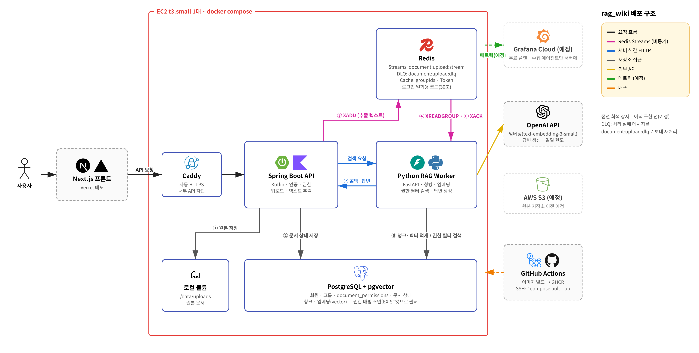
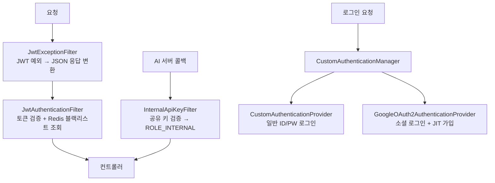
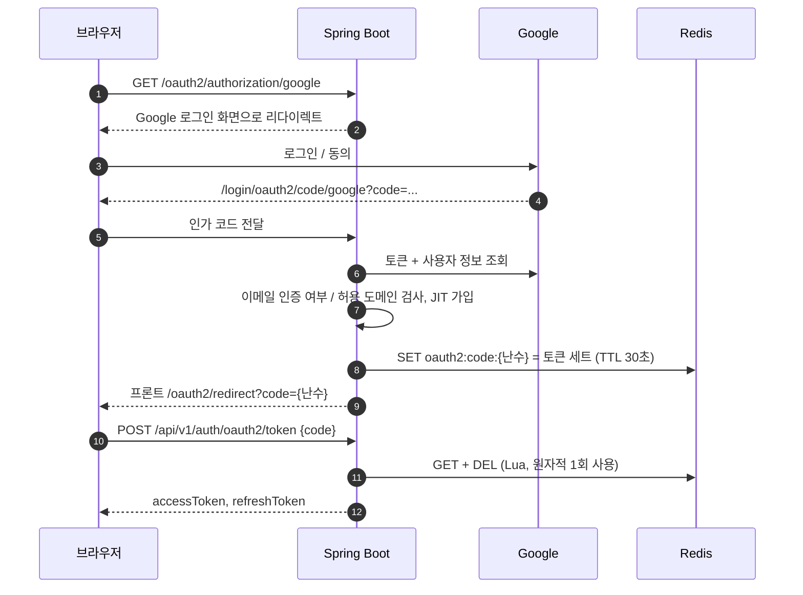
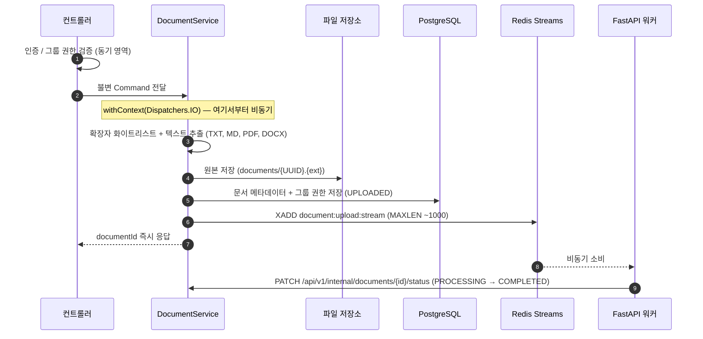
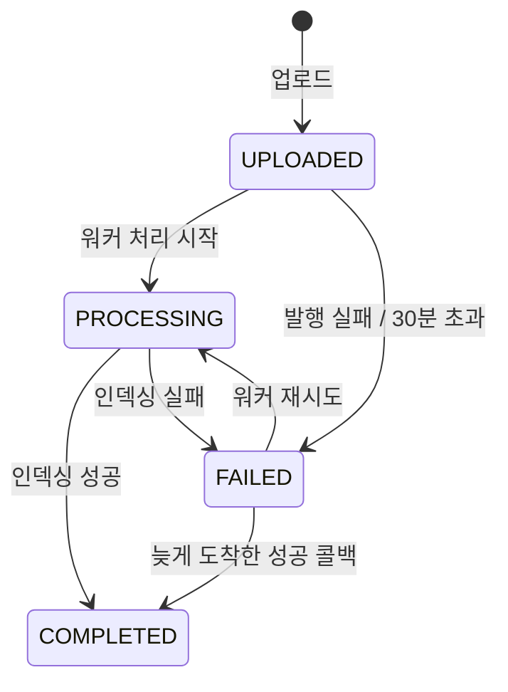
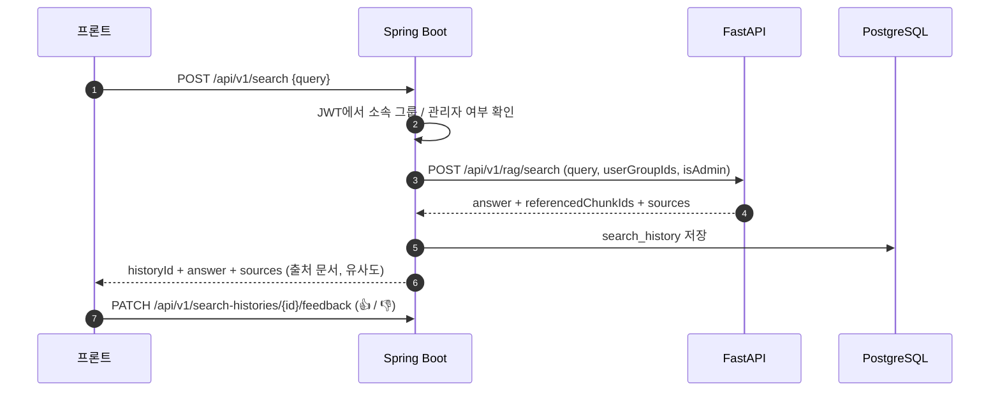
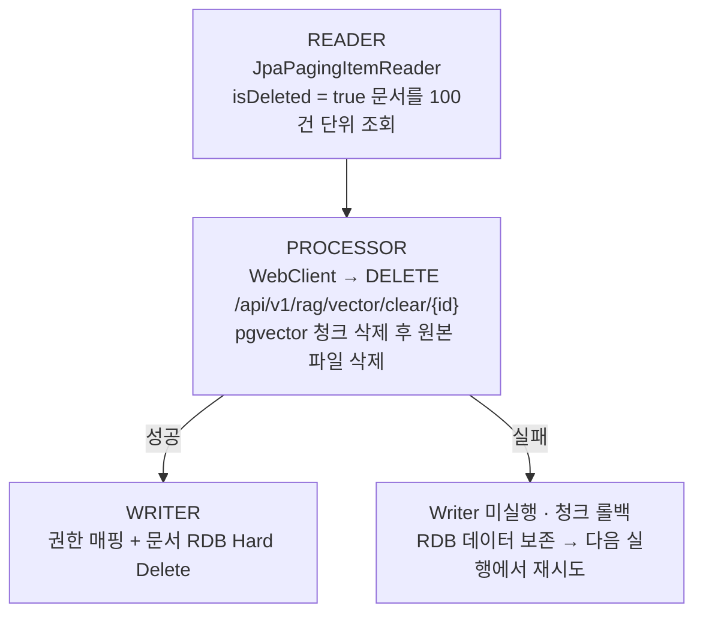
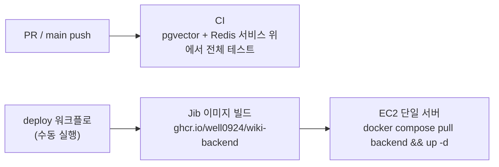

# RAG 기반 사내 위키 검색 에이전트 (Backend)

> Kotlin · Spring Boot · Spring Security · JWT · Redis · PostgreSQL · Coroutines · Redis Streams · Spring Batch

---

## 📌 프로젝트 개요

사내 문서를 업로드하면 Python FastAPI RAG 엔진이 벡터 인덱싱하고,
임직원이 자연어로 질의하면 AI가 소속 부서 권한 기반으로 필터링된 답변을 반환하는 사내 위키 검색 시스템입니다.

- **Python FastAPI AI 서버 저장소**: [rag_wiki_project_backend_ai](https://github.com/well0924/rag_wiki_project_backend_ai)

---

## 🛠️ 기술 스택

| 구분 | 기술 |
|---|---|
| Language | Kotlin |
| Framework | Spring Boot 3.x |
| Security | Spring Security + JWT + Redis Blacklist + Google OAuth2 |
| DB | PostgreSQL (+ pgvector, 벡터 테이블은 AI 서버 소유) |
| Cache / MQ | Redis (캐시, Refresh Token, Blacklist, 로그인 교환 코드, Streams) |
| Async | Kotlin Coroutines |
| ORM | Spring Data JPA (Hibernate 6) |
| Batch | Spring Batch (벡터 DB 정합성 배치) |
| Test | JUnit5 · Mockito-Kotlin · SpringBootTest |
| CI / 배포 | GitHub Actions · Jib · GHCR · Docker Compose · Caddy |

---

## 🏗️ 전체 아키텍처



> 점선 상자는 아직 구현 전(예정)입니다. 데이터 구조(ERD), 권한 규칙, 회원·그룹·문서 수명주기, Redis 키 구조는 [비즈니스 로직 상세](docs/business-logic.md)에 정리했습니다.

| 구분 | Spring Boot (이 저장소) | FastAPI (AI 서버) |
|---|---|---|
| 인증 / 권한 | JWT, 구글 로그인, 부서 그룹 권한 판정 | 전달받은 그룹 ID로 검색 범위 제한 |
| 문서 | 업로드 검증, 텍스트 추출, 원본 저장, 상태 관리 | 청킹, 임베딩, pgvector 적재 |
| 검색 | 검색 기록 / 피드백 저장 | 벡터 검색, LLM 답변 생성, 환각 방지 |

---

## 📁 패키지 구조

```
wiki_project/
├── common/
│   ├── exception/            ← 공통 예외, 에러코드
│   └── batch/                ← documentHardDeleteJob (벡터 DB 정합성 배치)
├── member/
│   ├── application/          ← MemberService, AdminService, AuthService
│   ├── domain/               ← MemberModel(data class), Entity, Mapper
│   └── infrastructure/
│       ├── security/         ← JWT, Filter, Provider, OAuth2, 로그인 교환 코드
│       └── repository/
├── document/
│   ├── application/          ← DocumentService (코루틴 + Redis Streams), FileStorage, 멈춤 문서 스케줄러
│   ├── infrastructure/       ← 텍스트 추출기, 로컬 파일 저장소, FastAPI 클라이언트
│   └── domain/
└── searchhistory/
    ├── application/          ← SearchUsecase (RAG 파이프라인 파사드), 검색 기록 / 피드백
    └── domain/
```

---

## 🔐 인증 시스템

### 설계 포인트

Spring Security를 기본 설정 없이 전부 커스텀했습니다.
라이브러리 내부(`ProviderManager`, `AuthenticationProvider`) 동작 방식을 직접 분석하고 아래 구조를 설계했습니다.



### 주요 전략

| 전략 | 내용 |
|---|---|
| **JWT Blacklist** | 로그아웃/탈퇴 시 Access Token을 Redis에 TTL로 등록하여 재사용 차단 |
| **RTR** | 재발급 시 구 Refresh Token 교체. 불일치 시 탈취 의심으로 토큰/캐시 즉시 파기 |
| **Redis 캐시** | `UserCacheData(MemberModel + groupIds + isAdmin)` 통합 캐싱으로 매 요청 DB I/O 방지 |
| **Soft Delete 가드** | 일반/소셜 로그인 양쪽 Provider에서 동일한 탈퇴 계정 차단 로직 적용 |
| **내부 API 분리** | AI 서버 전용 API(`/api/v1/internal/**`)는 공유 키로만 접근, 외부에서는 Caddy가 경로 자체를 차단 |

### 구글 로그인 — 일회용 코드 교환

로그인 성공 후 토큰을 리다이렉트 URL에 그대로 실으면 브라우저 기록, 서버 접근 로그, `Referer` 헤더로 토큰이 새어 나갑니다.
그래서 URL에는 **30초 동안 한 번만 쓸 수 있는 코드**만 싣고, 프론트가 POST 요청으로 토큰과 교환합니다.



| 항목 | 내용 |
|---|---|
| 코드 | 256bit `SecureRandom` 난수 (URL-safe Base64), 30초 TTL |
| 1회 사용 | `GET`과 `DEL`을 Lua 스크립트로 묶어 동시에 두 번 요청해도 한 번만 성공 (`GETDEL`은 Redis 6.2+ 전용이라 Lua로 대체) |
| 이메일 인증 | `email_verified`가 아닌 구글 계정은 거부 (회원을 이메일로 식별하므로 기존 계정 탈취 방지) |
| 허용 도메인 | `SSO_ALLOWED_DOMAINS=company.com` 지정 시 해당 Google Workspace(`hd`) 소속 계정만 가입/로그인. 비우면 모든 구글 계정 허용 (시연용 기본값) |
| 실패 처리 | 거부 사유를 `OAuth2FailureHandler`가 받아 프론트 로그인 화면에 메시지로 표시 |

---

## 📄 문서 업로드 파이프라인



Spring MVC 위에서 코루틴을 사용할 때 `ThreadLocal` 기반의 SecurityContext가 스레드 전환 시 유실되는 문제를,
**인증 완료 후 불변 Command 객체만 비동기 영역으로 전달**하는 방식으로 해결했습니다.

### 실패 대응

| 상황 | 처리 |
|---|---|
| 다중 업로드 중 일부 파일이 형식 오류 / 텍스트 없음 | 모든 파일 검증·추출을 먼저 끝낸 뒤 저장 → 일부만 저장되는 상황 방지 |
| 원본 저장 후 DB 저장 실패 | 저장한 원본 파일 삭제 (고아 파일 방지) |
| DB 저장 후 Streams 발행 실패 | 문서를 `FAILED`로 전환하고 503 응답 (UPLOADED 방치 방지) |
| AI 서버 처리 실패 | AI 서버가 최대 3회 재시도 후 DLQ로 격리, 재시도 성공 시 `FAILED → COMPLETED` 복구 |
| 상태 콜백이 끝내 오지 않음 | `StuckDocumentScheduler`가 30분 넘게 UPLOADED/PROCESSING인 문서를 `FAILED` 처리 |
| 스트림 무한 증가 | XADD 시 `MAXLEN ~1000` 근사 트리밍으로 최근 약 1,000건만 유지 |



---

## 🔍 검색 파이프라인



- 권한 필터, 유사도 하한, 출처 인용 강제 등 **환각 방지**는 AI 서버에서 처리합니다. ([AI 서버 README](https://github.com/well0924/rag_wiki_project_backend_ai#환각hallucination-방지))
- 응답의 `sources`로 프론트가 답변 근거 문서를 보여 주고, 사용자는 원문을 내려받아 직접 검증할 수 있습니다.
- 검색 기록과 피드백은 관리자 화면에서 품질이 낮은 답변(👎)을 찾아 문서를 보강하는 데 사용합니다.

---

## 🗂️ Spring Batch — 벡터 DB 정합성 관리

### 설계 배경

RDB와 Vector DB를 분리한 구조에서 문서 삭제 시 정합성 문제가 발생합니다.
Soft Delete로 표시된 문서의 벡터 청크와 원본 파일이 남아 있으면 저장 공간이 낭비되고,
검색 쿼리의 필터가 하나라도 빠지면 삭제된 문서가 답변에 섞일 수 있습니다.
`documentHardDeleteJob`이 매일 03:00에 실행되어 이를 정리합니다.

### 처리 흐름



### 핵심 설계 포인트

| 항목 | 내용 |
|---|---|
| **처리 순서** | Vector DB 삭제 선행 후 RDB Hard Delete — 순서 역전 시 고아 벡터 청크 잔존 위험 |
| **청크 크기** | 100건 단위 트랜잭션으로 메모리 부하 분산 |
| **페이지 고정** | 처리한 행이 삭제되어 조회 결과가 앞당겨지므로 항상 0페이지를 읽도록 고정 (페이지 건너뜀 방지) |
| **안전 장치** | Processor 실패 시 Writer 미실행 → RDB 데이터 보존 |
| **트랜잭션 관리** | `PlatformTransactionManager` 위임으로 수동 begin/commit 제거 |

> Soft Delete 이후 배치 실행 전까지 벡터 청크가 잔존하지만,
> AI 서버의 검색 쿼리가 `documents.is_deleted = false` 조건으로 즉시 제외하므로 검색 결과에 노출되지 않습니다.

---

## 🔥 트러블슈팅

### 1. UserGroupMemberId 복합키 인덱스 최적화

```kotlin
class UserGroupMemberId(
    var member: Long? = null,  // 선두 컬럼 → user_id 단일 조건 조회 시 PK 인덱스 활용
    var group: Long? = null
) : Serializable
```

`member(user_id)`를 복합 PK의 선두 컬럼으로 배치하여 PostgreSQL B-Tree 인덱스의
**Index Only Scan**을 유도했습니다. 별도 인덱스 없이 `user_id` 단일 조건 조회가 가능합니다.

### 2. MemberModel data class 전환

초기 설계에서 `class`로 작성된 도메인 모델이 `copy()` 미사용으로 인해
상태 변경 메서드마다 `isDeleted` 등 필드가 누락되는 버그가 잠재되어 있었습니다.

`data class`로 전환하여 `copy()`를 통한 불변 복사본 반환으로 리팩터링했습니다.

```kotlin
// 변경 전 - 필드 누락 위험
fun withdraw(): MemberModel {
    return MemberModel(id, email, password, userName, role, createdAt, LocalDateTime.now())
    // isDeleted 누락 → Soft Delete 미작동
}

// 변경 후
fun withdraw(): MemberModel {
    check(!this.isDeleted) { "이미 탈퇴한 회원입니다." }
    return copy(isDeleted = true, updatedAt = LocalDateTime.now())
}
```

### 3. Redis 캐시 구조 개선

초기에 `MemberModel`만 캐싱하여 캐시 히트 시에도 `groupIds` 조회를 위해 DB를 재조회하는 문제가 있었습니다.

`UserCacheData`로 통합하여 캐시 히트 시 DB 조회를 완전히 우회하도록 개선했습니다.

```kotlin
data class UserCacheData(
    val member: MemberModel,
    val groupIds: List<Long>,
    val isAdmin: Boolean
)
```

### 4. 소셜 로그인 토큰의 URL 노출

초기에는 로그인 성공 후 `/oauth2/redirect?accessToken=...&refreshToken=...`으로 토큰을 직접 넘겼습니다.
이 방식은 토큰이 브라우저 방문 기록과 서버 접근 로그에 남고, 다른 사이트로 이동할 때 `Referer` 헤더로도 전달될 수 있습니다.
Redis에 토큰을 보관하고 30초짜리 일회용 코드만 넘긴 뒤 POST로 교환하도록 바꿨습니다. ([구글 로그인 — 일회용 코드 교환](#구글-로그인--일회용-코드-교환))

### Redis CLI 한글 깨짐 (Windows PowerShell)

Windows PowerShell 기본 인코딩(CP949)과 Python Worker의 UTF-8 디코딩 불일치로 한글이 깨지는 현상 발생.

```powershell
chcp 65001  # UTF-8로 전환 후 redis-cli 실행
```

Worker에 인코딩 Fallback도 추가하여 운영 환경과 무관하게 방어 처리했습니다.

### Mockito + Kotlin Non-Null NPE

`any()`가 null을 반환하여 Kotlin non-null 타입에서 NPE 발생.
`mockito-kotlin` 라이브러리로 교체하여 해결했습니다.

### 코루틴 suspend 함수 단위 테스트

AssertJ의 `assertThatThrownBy` 람다 안에서 `suspend` 함수 호출 불가 문제.
`org.junit.jupiter.api.assertThrows`로 전환하여 해결했습니다.

---

## ✅ 테스트

| 테스트 | 내용 |
|---|---|
| `MemberModelTest` / `UserGroupModelTest` | 도메인 비즈니스 규칙 단위 테스트 |
| `AdminServiceTest` / `UserGroupServiceTest` | 권한 승격, 그룹 지정, 강제 추방, 그룹 관리 |
| `AuthServiceTest` | 로그인, 토큰 재발급, 탈취 의심 강제 파기, 소셜 로그인 코드 교환 |
| `JwtTokenProviderTest` / `CustomUserDetailsServiceTest` | 토큰 발급·검증, 캐시 히트 시 DB 미조회 |
| `CustomOAuth2UserServiceTest` | 이메일 미인증 거부, 허용 도메인(Workspace) 제한 |
| `OAuth2SuccessHandlerTest` / `OAuth2LoginCodeRepositoryTest` | 리다이렉트 URL에 토큰 미포함, 코드 1회 사용·TTL (실제 Redis) |
| `DocumentServiceTest` | 업로드 검증, 원본 저장/롤백, 발행 실패 시 FAILED, 권한 가드, 다운로드 |
| `DocumentTextExtractorTest` / `LocalFileStorageTest` | 형식별 텍스트 추출, 경로 조작 차단 |
| `DocumentHardDeleteJobTest` | 청크 크기(100) 초과 시에도 페이지 건너뜀 없이 전부 영구 삭제 |
| `StuckDocumentSchedulerTest` | 시간 초과 문서 FAILED 처리 |
| `InternalDocumentApiSecurityTest` | 내부 API 공유 키 인증 |
| `PythonClientConfigTest` / `SearchUsecaseTest` / `SearchHistoryServiceTest` | AI 서버 응답 파싱(sources 포함), 검색 기록 / 피드백 |
| `UserGroupMemberRepositoryTest` | 복합키 저장 및 인덱스 조회 |

---

## 🚀 CI / 배포



`deploy/` 디렉터리에 단일 서버 구성이 있습니다.

| 파일 | 내용 |
|---|---|
| `docker-compose.yml` | Caddy, Spring Boot, FastAPI, PostgreSQL(pgvector), Redis(AOF) |
| `Caddyfile` | 자동 HTTPS, `/api/v1/internal/*` 외부 차단 |
| `.env.example` | 서버 환경변수 예시 (`SSO_ALLOWED_DOMAINS` 등) |
| `setup-ec2.sh` | Docker 설치, 디렉터리 / 업로드 볼륨 준비 |

---

## 🔗 관련 저장소

- Python FastAPI RAG 서버: [rag_wiki_project_backend_ai](https://github.com/well0924/rag_wiki_project_backend_ai)
