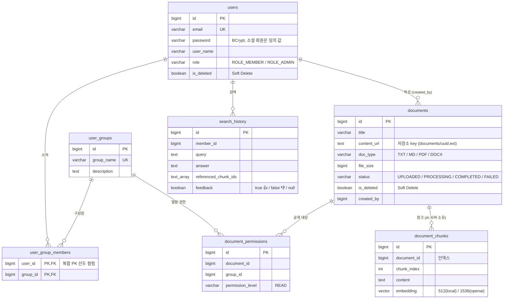
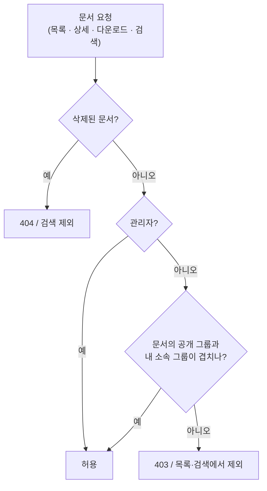
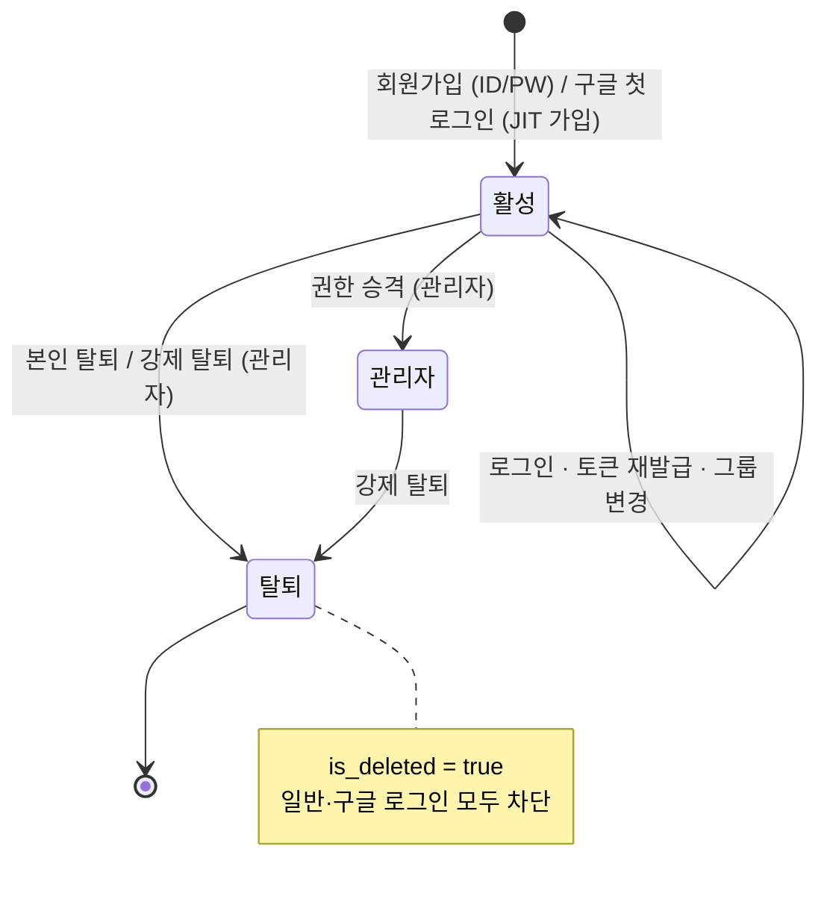
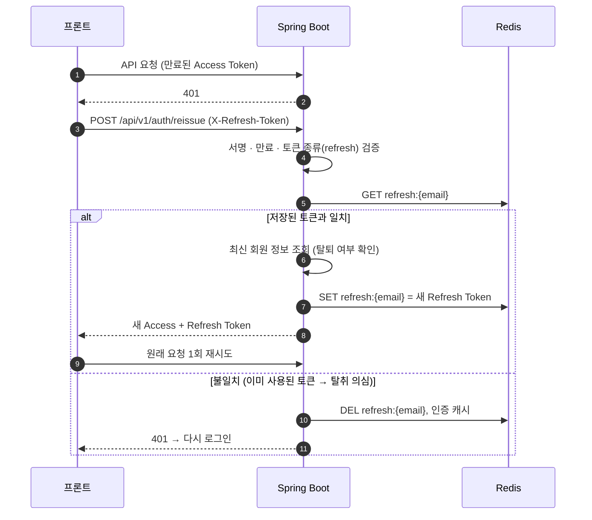
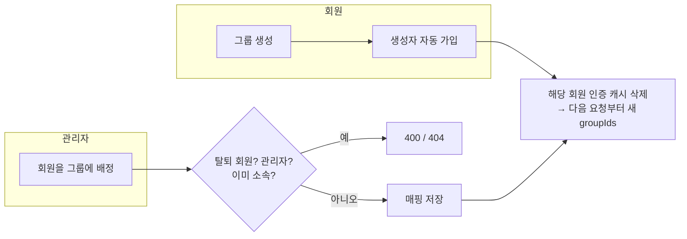
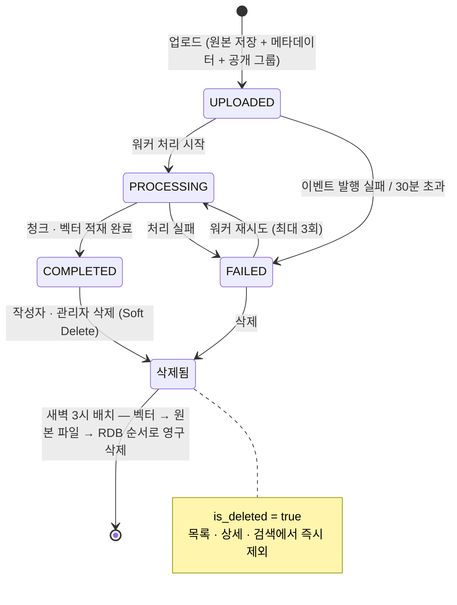
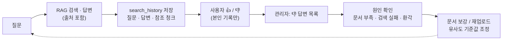

# 비즈니스 로직 상세

전체 구조는 [README](../README.md)의 아키텍처 그림을, 업로드·검색·로그인·배치의 처리 순서는 README의 각 절을 참고하세요.
이 문서는 **데이터 구조, 권한 규칙, 회원·그룹·문서의 상태 변화, 캐시 무효화 규칙**을 정리합니다.

---

## 1. 데이터 모델 (ERD)

| 설계 포인트 | 내용 |
|---|---|
| 권한은 "문서 ↔ 그룹" 매핑 하나로 표현 | 문서마다 공개할 그룹을 지정하고, 사용자는 소속 그룹을 통해 문서를 봅니다. 등급 없이 매핑이 있는지만 확인합니다. |
| `user_group_members` 복합 PK `(user_id, group_id)` | `user_id`를 선두 컬럼으로 두어 "내 그룹 조회"가 별도 인덱스 없이 PK 인덱스를 탑니다. |
| `document_chunks`는 AI 서버 소유 | 스키마 생성과 적재는 FastAPI가 담당하고, Spring은 `documents`/`document_permissions`만 관리합니다. 검색 시 AI 서버가 두 테이블을 조인합니다. |
| 회원·문서는 Soft Delete | 즉시 지우지 않고 `is_deleted`로 표시합니다. 문서는 매일 03:00 배치가 벡터·원본 파일과 함께 영구 삭제합니다. |

---

## 2. 역할과 권한

### 역할

| 역할 | 문서 열람 | 문서 업로드 | 문서 삭제 | 관리 기능 |
|---|---|---|---|---|
| `ROLE_MEMBER` | 소속 그룹에 공개된 문서만 | 소속 그룹에만 공개 가능 | 본인이 올린 문서만 | - |
| `ROLE_ADMIN` | 전체 문서 | 모든 그룹에 공개 가능 | 모든 문서 | 권한 승격, 그룹 배정, 강제 탈퇴, 검색 기록 / 👎 답변 조회 |

- 관리자는 전체 문서를 보므로 그룹에 소속시키지 않습니다 (`ADMIN_CANNOT_BE_ASSIGNED_TO_GROUP`).
- 권한 판정에 쓰는 `groupIds`, `isAdmin`은 JWT 클레임이 아니라 **Redis 인증 캐시(없으면 DB)의 최신 값**을 사용합니다. 그룹이 바뀌면 캐시만 지우면 다음 요청부터 즉시 반영됩니다.

### 문서 접근 판정

| 기능 | 판정 위치 | 방식 |
|---|---|---|
| 문서 목록 | Spring `DocumentRepository.findAccessibleDocuments` | 권한 매핑 조인, 관리자는 조건 생략 |
| 상세 · 다운로드 | Spring `DocumentService.getDocumentById` | `hasReadPermission` 확인 후 403 |
| RAG 검색 | AI 서버 검색 쿼리 | `EXISTS (document_permissions ...)` + `is_deleted = false` — 권한 없는 문서는 LLM 근거로도 쓰이지 않음 |
| 업로드 | Spring `DocumentController` | 일반 회원은 공개 대상 그룹이 모두 내 소속 그룹이어야 함 |
| 삭제 | 도메인 `DocumentModel.delete` | 작성자 또는 관리자만 |

---

## 3. 회원 · 세션 수명주기

### 토큰 재발급 (RTR, Refresh Token Rotation)

- 프론트는 동시에 여러 요청이 401을 받아도 재발급은 **한 번만** 요청하고 결과를 공유합니다.
- Refresh Token은 한 번 쓰면 바뀌므로, 탈취된 토큰이 먼저 사용되면 원래 사용자의 다음 재발급이 불일치로 감지됩니다. 이때 저장된 Refresh Token을 지워 양쪽 모두 더 이상 재발급할 수 없게 합니다. (이미 발급된 Access Token은 만료(30분)까지 유효 — 짧은 Access Token 수명으로 피해 시간을 제한)

### 세션 무효화 규칙

| 이벤트 | 인증 캐시 삭제 | Refresh Token 삭제 | Access Token 블랙리스트 |
|---|---|---|---|
| 로그아웃 | ✅ | ✅ | ✅ (남은 유효 시간만큼) |
| 본인 탈퇴 | ✅ | ✅ | ✅ |
| 강제 탈퇴 (관리자) | ✅ | ✅ | - (다음 요청에서 탈퇴 상태로 차단) |
| 관리자 승격 | ✅ | ✅ (재로그인 유도) | - |
| 그룹 배정 / 그룹 생성 / 그룹 삭제 | ✅ (해당 회원들) | - | - |
| 재발급 시 토큰 불일치 | ✅ | ✅ | - |

---

## 4. 그룹 관리

| 규칙 | 내용 |
|---|---|
| 그룹 이름 | 필수, 100자 이하, 중복 불가 (수정 시 자기 자신 제외) |
| 그룹 생성 | 로그인한 회원 누구나 생성 가능, 생성자는 자동으로 구성원이 됨 |
| 다른 회원 배정 | 관리자만 가능 (탈퇴 회원 · 관리자 · 이미 소속된 회원은 거부) |
| 그룹 삭제 | 구성원 매핑을 먼저 지우고 그룹 삭제, 구성원 전원의 인증 캐시 삭제 |

---

## 5. 문서 수명주기

- 완료된 문서는 다시 처리 중 상태로 돌아가지 않습니다 (`DocumentModel.startProcessing`).
- 벡터 삭제가 실패하면 RDB 삭제를 하지 않고 다음 배치에서 다시 시도합니다. 순서를 거꾸로 하면 RDB에는 없는데 벡터만 남는 고아 데이터가 생깁니다.

---

## 6. 검색 품질 피드백 순환

- 다른 사람의 검색 기록에는 피드백을 남길 수 없습니다 (`FORBIDDEN_HISTORY_ACCESS`) — 품질 지표 오염 방지.
- 검색 기록에는 답변 근거가 된 청크 ID가 남아 있어, 👎 답변이 어떤 문서 조각을 근거로 만들어졌는지 추적할 수 있습니다.

---

## 7. Redis 키 구조

| 키 | 값 | TTL | 용도 |
|---|---|---|---|
| `refresh:{email}` | Refresh Token | 14일 | 재발급 검증 (RTR) |
| `blacklist:{accessToken}` | `logout` | Access Token 남은 유효 시간 | 로그아웃 / 탈퇴 토큰 차단 |
| `user-cache:v2:{email}` | 회원 + groupIds + isAdmin (JSON) | 30분 | 요청마다 DB 조회 없이 인증 · 권한 판정 |
| `oauth2:code:{code}` | Access + Refresh Token | 30초 | 구글 로그인 일회용 교환 코드 |
| `document:upload:stream` | documentId, content, title … | 최근 약 1,000건 (MAXLEN) | 인덱싱 이벤트 (Consumer Group `fastapi-ai-group`) |
| `document:upload:dlq` | 원본 필드 + 실패 사유 | 최근 1,000건 | 처리 불가 메시지 격리 |
