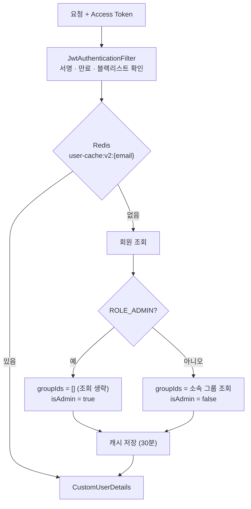
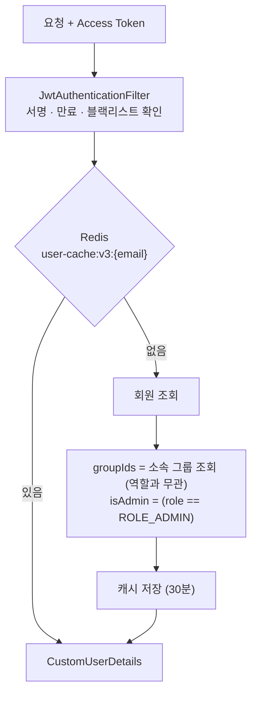
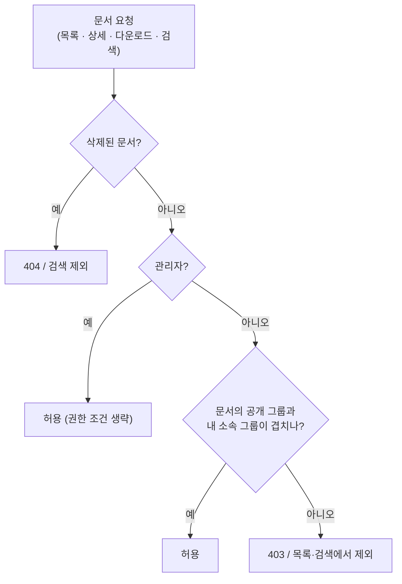
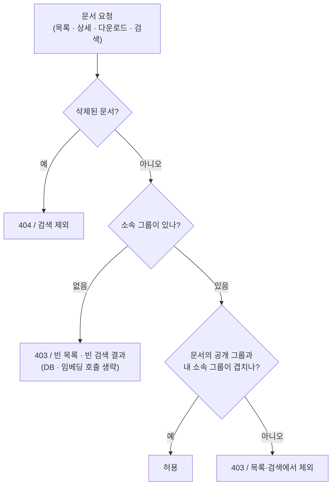
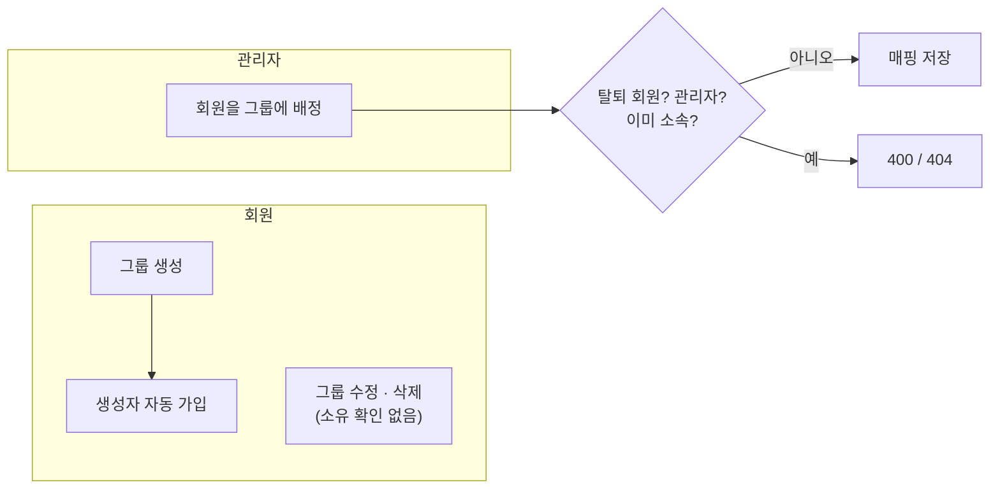
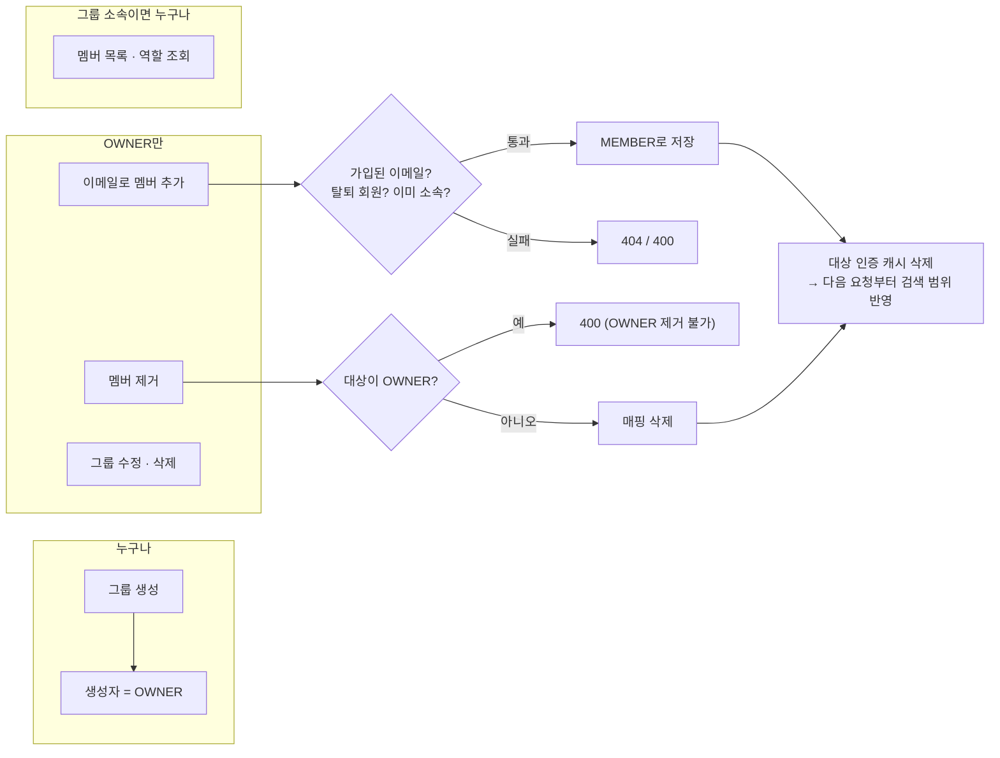

# 권한 모델 변경: 사내 부서 위키 → 범용 그룹(워크스페이스)

2026-11-04 변경. 현재 규칙은 [비즈니스 로직 상세](business-logic.md)의 2·4절에 반영되어 있고, 이 문서는 **무엇이 왜 바뀌었는지**와 변경 전후 흐름을 기록합니다.

---

## 1. 왜 바꿨나

처음 설계는 "회사 한 곳의 부서별 위키"였습니다. 관리자는 회사의 전산 담당자로 보고 모든 문서를 볼 수 있게 했고, 회원을 부서에 넣는 것도 관리자만 했습니다.

로컬에서 직접 써 보면서, 이 서비스를 회사 팀뿐 아니라 스터디나 개인 공간으로도 쓸 수 있게 하기로 했습니다. 그러자 기존 규칙에서 세 가지 문제가 드러났습니다.

| 문제 | 기존 동작 | 범용 서비스에서 생기는 일 |
|---|---|---|
| 그룹 안의 역할이 없음 | 소속 여부만 있고, 그룹 수정·삭제 API는 로그인만 하면 누구나 호출 가능 | 상관없는 회원이 남의 스터디 그룹을 지울 수 있음. 지워지면 그 그룹 멤버 전원이 문서 열람 권한을 잃음 |
| 멤버 추가는 관리자만 | `POST /api/v1/admin/members/assign-group` 하나뿐 | 스터디를 만들어도 친구를 넣으려면 운영자에게 부탁해야 함 |
| 관리자는 모든 문서를 봄 | 목록·상세·다운로드·검색에서 관리자는 권한 조건을 건너뜀 | 운영자가 다른 사람의 개인 문서와 스터디 문서까지 검색하고 내려받을 수 있음 |

---

## 2. 바뀐 규칙 한눈에 보기

| 항목 | 변경 전 | 변경 후 |
|---|---|---|
| 그룹 안 역할 | 없음 (소속 / 미소속) | `OWNER`(만든 사람), `MEMBER` (`user_group_members.role`) |
| 그룹 수정 · 삭제 | 로그인한 누구나 | 그 그룹의 OWNER만 (`GROUP_OWNER_ONLY`, 403) |
| 멤버 추가 | 관리자 배정만 | OWNER가 이메일로 바로 추가 (`POST /api/v1/groups/{id}/members`). 관리자 배정 API도 유지 |
| 멤버 제거 | API 없음 | OWNER만, OWNER 자신은 제거 불가 (`GROUP_OWNER_CANNOT_BE_REMOVED`) |
| 멤버 목록 | API 없음 | 그룹 소속이면 누구나 (`GROUP_MEMBER_ONLY`, 403) |
| 관리자 문서 열람 | 전체 문서 | **소속 그룹에 공개된 문서만** (일반 회원과 같음) |
| 관리자 업로드 | 아무 그룹에나 공개 가능 | 소속 그룹에만 공개 가능 |
| 관리자의 그룹 소속 | 금지 (`ADMIN_CANNOT_BE_ASSIGNED_TO_GROUP`) | 허용 (규칙 삭제) |
| 업로드 공개 그룹 | 비워도 됨 (관리자만 볼 수 있는 문서가 됨) | 1개 이상 필수 (`@NotEmpty`) — 비우면 아무도 못 보는 문서가 되므로 |
| 관리자에게 남은 권한 | - | 회원 관리(`/api/v1/admin/**`), 검색 품질 지표 · 👎 목록, 문서 삭제(신고 대응) |

`ROLE_ADMIN`은 "운영자"로 의미가 바뀌었습니다. 운영자는 회원과 서비스 품질을 관리하지만, 문서 내용을 볼 권한은 그룹 소속으로만 얻습니다.

---

## 3. 인증 · 권한 정보가 만들어지는 흐름

요청마다 JWT 필터가 회원 정보를 읽어 `CustomUserDetails(member, groupIds, isAdmin)`를 만듭니다. 권한 판정은 JWT 클레임이 아니라 이 값(Redis 캐시, 없으면 DB)을 씁니다.

### 변경 전

관리자는 "어차피 다 본다"는 전제로 소속 그룹을 조회하지 않았습니다. 그래서 `groupIds`가 항상 빈 목록이었습니다.

### 변경 후

- 관리자도 소속 그룹을 조회합니다 (`MemberQueryService.findGroupIds`).
- `isAdmin`은 남아 있지만, **관리자 기능의 접근 판단에만** 씁니다. 문서 권한 판정에는 쓰지 않습니다.
- 캐시 키 버전을 `v2` → `v3`으로 올렸습니다. `v2`의 관리자 캐시는 `groupIds`가 빈 목록이라, 그대로 읽으면 배포 후 최대 30분 동안 관리자에게 문서가 하나도 보이지 않기 때문입니다. `v2` 키는 읽지 않고 TTL로 사라집니다.

---

## 4. 문서 접근 판정 흐름

### 변경 전

### 변경 후

관리자 분기가 사라지고, 모든 사용자가 같은 길을 지납니다.

### 코드 위치별 변경

| 기능 | 위치 | 변경 전 | 변경 후 |
|---|---|---|---|
| 문서 목록 | `DocumentRepository.findAccessibleDocuments` | `(:isAdmin = true OR p.groupId IN :groupIds)`, `LEFT JOIN` | `p.groupId IN :groupIds`, `JOIN`. 소속 그룹이 없으면 서비스에서 쿼리 없이 빈 목록 |
| 상세 · 다운로드 | `DocumentService.getDocumentById` | 관리자면 `hasReadPermission` 생략 | 항상 확인. 소속 그룹이 없으면 쿼리 없이 403 |
| 업로드 | `DocumentController.uploadDocument` | 관리자면 공개 그룹 검사 생략 | 항상 "공개 그룹 ⊆ 내 소속 그룹" 검사 |
| RAG 검색 (Spring) | `SearchController` → `PythonClientConfig` | `isAdmin`을 AI 서버로 전달 | `userGroupIds`만 전달 |
| RAG 검색 (AI 서버) | `rag_service.search_relevant_chunks_with_permission` | `CAST(:is_admin AS boolean) OR EXISTS (...)` | `EXISTS (...)`만. 소속 그룹이 없으면 임베딩 생성 없이 빈 결과 |
| 삭제 | `DocumentModel.delete` | 작성자 또는 관리자 | 변경 없음 (관리자 삭제는 신고 대응용으로 유지) |

---

## 5. 그룹 관리 흐름

### 변경 전

### 변경 후

- 요청자가 OWNER인지는 `user_group_members`의 `(requesterId, groupId)` 행의 `role`로 확인합니다 (`GroupService.requireOwner`). 소속이 아니거나 MEMBER면 403입니다.
- 초대 수락 단계는 없습니다. 가입된 회원의 이메일을 입력하면 바로 MEMBER가 됩니다. 노션식 초대 메일 · 수락 흐름은 후속 과제입니다.

---

## 6. 데이터 변경과 이행

| 변경 | 내용 |
|---|---|
| `user_group_members.role` 추가 | `varchar(20) default 'MEMBER' not null`. 기존 행이 있는 테이블에 `ddl-auto=update`로 추가해도 NOT NULL 위반이 나지 않도록 DB 기본값을 둠 |
| 기존 매핑 | 모두 `MEMBER`가 됨 → 기존 그룹에는 OWNER가 없음. 새 DB(배포)는 해당 없음. 로컬은 `UPDATE user_group_members SET role = 'OWNER' WHERE user_id = ? AND group_id = ?`로 지정 |
| Redis 인증 캐시 | `user-cache:v2` → `v3` |
| Spring ↔ AI 서버 계약 | 검색 요청에서 `isAdmin` 제거. 새 AI 서버는 `isAdmin`이 와도 무시하지만, **예전 AI 서버는 `isAdmin`을 필수로 받으므로 두 서버를 함께 배포**해야 함 |

---

## 7. 남은 과제

| 과제 | 이유 |
|---|---|
| 👎 상세 목록을 그룹 OWNER 범위로 제한 | 지금은 관리자가 모든 사용자의 질문과 답변을 봄. 답변에 개인 문서 내용이 들어갈 수 있음 |
| 그룹 이름 전역 중복 금지 해제 | `group_name`이 서비스 전체에서 unique라, 서로 다른 스터디가 같은 이름을 쓸 수 없음 |
| 초대 수락 흐름 | 지금은 이메일 입력 즉시 추가 |
| OWNER 위임 · 그룹 나가기 | OWNER가 탈퇴하면 그룹을 관리할 사람이 없어짐 |
